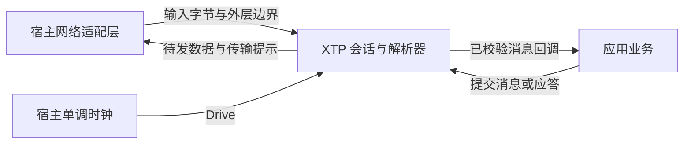

# XTP 3.0 扩展库设计方案

日期：2026-11-16。状态：P1～P6 功能已实现，P7 已提供 XS 替换、包消费及可复现性能验收；生产资格缺口单独记录。适用产品：`extlibs/xtp`。实际覆盖见 [实施与验收](../../extlibs/xtp/docs/coverage.md)。

XTP 3.0 是纯 C、有界、双向的二进制消息协议。固定头为 32 字节，支持字符串或 UInt32 命令、table 或 array 参数，以及请求应答、可靠推送、不可靠推送。业务自行路由；网络适配层提供字节、报文边界、可信连接状态及发送出口；XTP 完成分帧、校验、消息回调和待发数据管理。

本方案完整替换 XTP 1.0/2.0，不提供旧版本解析器、源码 ABI、降级、探测或转换。确定性指相同输入、状态和时钟产生相同协议结果，资源和单次工作量有上限；不承诺网络实时性或远端业务恰好执行一次。

## 1 产品边界

### 1.1 必须交付的能力

- 固定格式编解码、完整帧借用解码、流式半包和粘包处理。
- 连续多帧编码与拆分、UDP/WS 外层报文边界处理。
- 有界的坏帧丢弃、明确的不可恢复错误及 EOF。
- 数字或字符串命令、table 或 array 二进制参数、独立 Body。
- 双向并发请求、乱序应答、可靠推送回执、不可靠推送。
- 有界待发队列、短写与背压、时钟驱动、请求期限及完成通知。
- 可选的内存发件箱、重连后重投、去重和结果回收。
- 已有 TCP/TLS、xws 和 xrudp 的可选适配；裸 UDP 可使用报文编解码。
- 模块化源码、独立扩展单头、示例、故障测试与性能测量。

### 1.2 保持在外部的能力

路由注册、线程池、游戏同步与预测、账号权限、数据库事务、业务幂等、磁盘消息队列和媒体编解码均由应用或独立扩展提供。XTP 不重新实现 TLS、Noise、可靠 UDP、网络拥塞控制、NAT 穿透或 WebSocket。

XTP 核心不创建 socket、Engine、线程或后台定时器，不覆盖宿主已有的事件表和用户数据。扩展仅使用 XRT 公共 API，不包含核心 `src/internal/`。

## 2 分层与调用关系



| 部分 | 职责 | 必须依赖 |
| --- | --- | --- |
| Codec | 线路整数、长度校验、编码、借用视图、参数访问 | XRT 基础类型；成功路径无堆分配 |
| Session | Input、回调、pending、回执、输出、期限和配额 | Codec、XRT 公共内存 API |
| Delivery | 内存保留、受控续接、重投、去重及结果确认 | Session；创建新恢复会话时使用安全随机源 |
| 适配 | 连接生命周期、输入出口、可写通知、可信绑定 | 所选 TCP/TLS、xws 或 xrudp |

时间以调用者注入的 UInt64 单调微秒表示。`Drive(now, &next_due)` 返回下一维护期限；没有输入时，主动发送、异步应答和到期维护也能产生输出。

Input、Submit、Reply、Bind/Unbind、Advance 及其他会创建或改变期限的入口均接收本次操作的 NowUs。适配层在实际调用时取得新鲜单调时间，不能用上次 Drive 的旧时间代替 API 提交时刻；只读 Codec 和查询不需要时钟。

所有回调在当前实例的所属执行者上同步调用。不同会话可在不同 Worker 并行；同一实例的所有可变操作串行。没有全局路由表、全局会话锁或逐消息线程。

## 3 线路格式

### 3.1 固定头

所有多字节整数均为 little-endian，无隐式 padding。Status 使用 32 位二进制补码。使用显式 load/store，不用结构体强转或 `memcpy(struct)` 处理线路数据。

| 偏移 | 字段 | 字节 | 类型与规则 |
| --- | --- | ---: | --- |
| 0 | Magic | 4 | 固定 `78 74 70 03`，即 `xtp` 加二进制版本 3 |
| 4 | FrameSize | 4 | UInt32，总帧长度，包含固定头 |
| 8 | MessageID | 8 | UInt64，关联请求、推送、结果或回执 |
| 16 | Type | 1 | UInt8，见消息类型表 |
| 17 | Flags | 1 | UInt8，见标志位表 |
| 18 | CommandSize | 2 | UInt16，字符串命令字节数 |
| 20 | MetadataSize | 4 | UInt32，整个参数区字节数 |
| 24 | Status | 4 | Int32，零成功，非零拒绝或错误 |
| 28 | CommandID | 4 | UInt32，数字命令 |
| 合计 | 固定头 | 32 | 所有类型使用相同布局 |

```text
Header[32] | Command[CommandSize] | Metadata[MetadataSize] | Body

BodySize = FrameSize - 32 - CommandSize - MetadataSize
```

先在宽整数中验证 `FrameSize >= 32`、`32 + CommandSize + MetadataSize <= FrameSize` 和所有配置上限，再计算差值、转换到 size_t 或移动指针。不为头部声明的整个大包立即分配内存。

### 3.2 消息类型

| 数值 | 名称 | MessageID | Status | 路由与内容 |
| ---: | --- | --- | --- | --- |
| 1 | REQUEST | 非零 | 必须零 | 有路由，可带参数和 Body；等待 RESPONSE |
| 2 | RESPONSE | 回显 REQUEST ID | 零或错误码 | 无路由，可带结果参数和 Body |
| 3 | PUSH | 非零 | 必须零 | 有路由，可带参数和 Body；等待 ACK |
| 4 | ACK | 回显被确认的 ID | 按确认种类校验 | 无路由、无参数、无 Body，固定 32 字节 |
| 5 | NOTIFY | 必须零 | 必须零 | 有路由，可带参数和 Body；无 XTP 回执或重投 |

其他类型不解释。Type 仅描述协议语义，不指定业务处理器。

### 3.3 标志位

| 值 | 名称 | 含义与允许类型 |
| --- | --- | --- |
| `0x01` | ROUTE_ID | REQUEST/PUSH/NOTIFY 使用数字命令 |
| `0x02` | PARAM_ARRAY | REQUEST/RESPONSE/PUSH/NOTIFY 使用 array 参数 |
| `0x04` | RESULT_ACK | 仅 ACK：可恢复 RESPONSE 的结果回执：已消费或明确退休 |
| `0x08` | REPLAYABLE | 仅 REQUEST/PUSH：请求双方保留恢复所需的身份与结果状态 |

其他位必须零。不使用同一位同时控制命令和参数，四种组合全部合法。RESULT_ACK 和 REPLAYABLE 只在启用并约定 Delivery 时使用；普通 RPC 不增加这一回执。接收方不支持 REPLAYABLE 时，在执行业务前明确返回 UNSUPPORTED，不能静默忽略后执行。Submit 根据交付选项设置 REPLAYABLE，重投保留原标志；RESPONSE 不回显此位，双方通过对应请求记录判断是否需要结果确认。

### 3.4 路由字段

- 字符串模式：ROUTE_ID=0，CommandSize>0，CommandID=0。
- 数字模式：ROUTE_ID=1，CommandSize=0，CommandID 为完整 UInt32 范围，零也合法。
- RESPONSE/ACK：ROUTE_ID=0，CommandSize=0，CommandID=0。
- 字符串 Command 使用非空可打印 ASCII `0x21..0x7e`，大小写敏感，不做 URL 解码、大小写折叠或字符串补零。
- 数字与字符串不互相回退，不从字符串隐式生成 CommandID，也不为应用注册映射。

应用负责 CommandID 分配和业务 schema。改变参数顺序、值类型或含义时，使用新的业务版本或 CommandID。XTP 协议版本不替代业务版本。

### 3.5 标准拒绝码

`0` 表示成功。正值为应用错误码；`-1..-9` 固定如下，其余负值保留。

| 值 | 名称 | 含义 |
| ---: | --- | --- |
| -1 | BUSY | 明确尚未受理，可按有限退避重试 |
| -2 | REJECTED | 明确拒绝，不自动重试 |
| -3 | UNSUPPORTED | 不支持该业务能力或交付策略 |
| -4 | BAD_ARGUMENT | 业务参数不满足命令约定 |
| -5 | RESULT_TOO_LARGE | 结果超过已约定的响应限制 |
| -6 | INTERNAL | 接收端处理失败；不承诺没有业务效果 |
| -7 | NOT_FOUND | 应用未找到对应命令或目标 |
| -8 | STATE_LOST | 旧身份或结果状态不足，历史受理或执行结果未知，禁止自动当新消息重试 |
| -9 | DEADLINE_EXCEEDED | 接收端请求期限已过；可能已有业务效果，不能作为未执行证明 |

普通非零 ACK 表示本轮 PUSH 未被接管；STATE_LOST 另表示历史结果未知，不构成从未受理的证明。只有 BUSY 可以触发管理器的有限重试。已经返回成功 ACK 的 PUSH 不再改判拒绝。RESULT_ACK 的 Status 为零表示已消费，为 STATE_LOST 表示已退休/不再保留；其他状态非法。DEADLINE_EXCEEDED 只用于 RESPONSE。ACK 的 INTERNAL 也只能在接管前使用，不能将已产生业务效果的 PUSH 改报未受理。

本地错误使用独立的 C 返回枚举；不把本地 OOM、解析错误或超时混作远端 Status。对无法信任的头部不自动生成错误回复。

## 4 参数区

### 4.1 共同规则

MetadataSize=0 是无参数的唯一规范编码。非空参数区以 UInt16 Count 开始，Count 必须大于零。首版实现参数数量硬上限为 256，默认 64；这是资源策略，不改变 Count 的线宽。

参数值和 Body 均为显式长度的二进制视图，允许零长度和嵌入 NUL。库不创建 xvalue、xdict、参数字符串或数字对象。值的类型、字节序及必需字段由应用 schema 定义。

API 中的 ParamID 是 array 或 table 的零起始位置下标，不是另一个在线路上传输的稀疏数字 key。两种模式都保留发送时的输入顺序，均可使用 ParamAt；table 额外支持按字符串 key 查找。Command 与参数的四种组合及统一回调见 [消息 API 与回调设计](xtp3-api.md)。

所有结束偏移相对于参数数据区起点，不包含 Count 和描述表。完整验证参数区后才交付消息。最后一个结束偏移必须等于数据区长度，拒绝隐藏尾字节、回退偏移和越界项。

### 4.2 Array 模式

```text
Count:u16 | EndOffset:u32[Count] | ValueBytes
```

第 i 项起点为 i=0 时的零，否则为 EndOffset[i-1]；终点为 EndOffset[i]。结束偏移允许相等，以表示空值。

验证为 O(Count)，验证后的按下标访问为 O(1)，不扫描前面的参数、不比较字符串、不分配索引。

示例三个值 `01`、`02 03`、空值，参数区为 17 字节：

```text
03 00
01 00 00 00 03 00 00 00 03 00 00 00
01 02 03
```

### 4.3 Table 模式

```text
Count:u16 | Entry[Count] | KeyValueBytes
Entry = KeySize:u16 + EndOffset:u32        每项恰好 6 字节
数据项 = Key[KeySize] + Value
```

数据项起点由上一结束偏移确定，ValueSize 为该项总长减 KeySize。Key 非空，只允许 `[a-z0-9_.-]`，重复 key 非法。Entry 和数据项严格保留传入 xtpTable 的 fields 顺序，线上不要求 key 有序，编码器和解码器都不得重新排列参数。

ParamAt 对 table 直接定位第 i 项 Entry，从上一结束偏移取得该项起点，再跳过 KeySize 返回 Value，成本为 O(1)，不比较 key。ParamNext 按相同输入顺序返回 Index、Key 和 Value。依赖位置读取的业务负责约定参数顺序；XTP 不根据 Command 或 key 自动转换成另一种业务顺序。

ParamFind 按原顺序查找完整 key，首版成本为 O(Count) 次有界比较，不创建常驻字典或查找索引。编码与解码预检使用有界临时索引检查重复 key；可对至多 256 个 UInt16 索引作堆排序后检查相邻 key，索引不超过 512 字节，比较次数为 O(Count log Count)，不进行逐参数堆分配。临时索引仅用于校验，不改变 Entry、数据项或接收视图的顺序，校验后也不在每次访问时重新建立索引。Array 无 key 校验或去重成本。

示例输入顺序为 `b=02 03`、`a=01`，参数区为 19 字节；ParamAt(0) 返回 `02 03`，ParamAt(1) 返回 `01`，ParamFind("a") 与 ParamAt(1) 返回同一值：

```text
02 00
01 00 03 00 00 00 01 00 05 00 00 00
62 02 03 61 01
```

## 5 请求与推送语义

### 5.1 MessageID

Session 为本方向的 REQUEST/PUSH 共用一个从 1 开始的 UInt64 递增序列，仅在提交成功后消耗 ID。达到上限时拒绝新提交，不能回绕。同一逻辑会话的续接保持原序列。

两方向各有自己的序列；RESPONSE/ACK 关联本端发出的 pending，REQUEST/PUSH 属于对端发出的命名空间。关联时同时验证预期类型，不能用 PUSH ACK 完成 REQUEST。

裸 Codec 可以按调用者提供的 ID 编解码；自管 ID 的用户必须遵守不复用规则。Session 不提供修改活跃 ID 的入口。

### 5.2 请求应答

允许多个请求在途和响应乱序。请求从 API 受理时开始计算绝对期限，包含待发队列、网络及业务时间。

回调可以同步 Reply，也可以接管请求令牌后异步 Reply。令牌包含实例代、逻辑会话代和请求槽代，迟到 Reply 不得命中新槽。经过验证的网络续接不使仍活跃的逻辑请求令牌失效，Reply 使用当前有效绑定；换成新逻辑会话或请求期限结束才使旧令牌失效。网络输出 Ticket 仍使用独立的绑定代。宿主必须保持实例和回调代码存活至异步任务结束。

接收端另有从受理起计算的 IncomingRequestTimeout。它不读取对端的时钟，也不推断对端逐条设置的期限；需要传播业务 deadline 时，由应用 schema 明确携带。接收端到期后可返回 DEADLINE_EXCEEDED 并使旧令牌失效，但不强制终止已经运行的应用任务。

同一请求最多提交一个终态 RESPONSE。合法非零 Status 是远端错误结果。迟到、重复或未知响应不交付新业务结果，按有界策略计数；不自动生成响应的响应。

### 5.3 可靠推送

PUSH 的成功 ACK 固定表示：接收端已经接管消息，承担后续投递责任。默认接管点为应用回调明确返回 ACCEPT；应用需要排队时，先把所需数据复制或保留到自己的有界队列，再返回 ACCEPT。

XTP 在调用业务前预留 ACK 和去重状态所需预算。不能在业务已经接管后，才发现没有空间记录受理事实。

BUSY/REJECT 必须表示未接管且未产生该消息的业务效果。BUSY 保留同一 ID，按退避重试；其他明确拒绝结束操作。ACK 不是业务执行结果，也不证明数据落盘。

### 5.4 不可靠推送

NOTIFY 不占 pending、发件箱或回执状态；接收端过载时允许丢弃，不自动重投。在 TCP/WS 上只是 XTP 不确认和不恢复，底层仍可靠有序；真正的时效性数据应走 xrudp DATAGRAM。

NOTIFY 的应用 Tick、实体版本和序号放在参数或 Body，或使用 xrudp 通道提供的序号。MessageID 不复用为业务时间或网络包号。

### 5.5 完成结果

完成通知分别携带本地原因、远端 Status 和执行认知：

| 认知 | 允许声明的事实 |
| --- | --- |
| NOT_SENT | 尚无任何字节被下层受理 |
| UNKNOWN | 可能已到达或执行，未取得终态证明 |
| ACCEPTED | 收到 PUSH 的成功 ACK，对端已接管 |
| REPLIED | 收到匹配 RESPONSE，业务结果由 Status 和内容说明 |
| REJECTED | 对端明确未受理；不能套用于已经可能执行的本地超时 |

发送受理、下层发送完成、传输 ACK、业务 ACK 和 RESPONSE 各自独立。超时、关闭和取消不能伪造未执行证明。首版没有独立 Cancel API；应用可以在提交前取消，已受理操作由原期限或显式关闭终结，不发送业务撤销协议。

STATE_LOST 始终以 UNKNOWN 完成，即使携带在一个语法合法的 ACK 或 RESPONSE 中。DEADLINE_EXCEEDED 是远端期限结果，不证明业务没有执行。

## 6 输入与异常处理

### 6.1 输入模式

每个绑定的接收 lane 有独立的解析状态，不能把不同流或 UDP 对端的半包混合。

- STREAM：帧可跨任意输入片段。一次 Input 循环交付多帧，保留最后半包。
- RECORD：外层报文可包含一个或多个完整帧。宿主传入 RecordEnd；不完整尾帧不能延续到下一报文。WS 的 Data 分片可多次输入，到 MessageEnd 才传 RecordEnd。
- 零长度输入不表示 EOF。显式 End 在帧边界成功，在半帧处报告 TRUNCATED。

空 RECORD 为无操作；独立 Decode 仍要求恰好一个完整帧，空输入返回 TRUNCATED。RecordEnd 会清除当前外层边界状态，不能把 UDP 丢弃状态带到下一数据报。

Input 始终报告准确 Used；未消费后缀归宿主。受预算或业务 PAUSE 影响时，宿主保留后缀，恢复后立即继续，不只等待下一次网络通知。

连续可用的完整帧使用借用视图；需要跨片段时才复制到可复用的组包缓冲。回调视图只在回调内有效。保留消息使用显式整帧副本，再从副本建立视图；浅拷贝结构体不延长寿命。

解析先完成头部、路由、参数区和配置限制校验，再调用业务。一次批量输入不构成业务事务；已经交付的合法帧不会因后续坏帧而回滚。

### 6.2 丢弃边界

| 输入情况 | 处理 |
| --- | --- |
| 合法帧边界内参数格式、字段组合或未知类型非法 | DROP_FRAME：准确跳过该帧，可继续下一帧 |
| STREAM 的 magic、版本、总长或区域长度关系失效 | FATAL：停止该 lane，由适配层终止对应连接或流 |
| 声明帧超过本地 MaxFrame | STREAM 立即 FATAL；RECORD 丢弃当前外层报文剩余部分 |
| RECORD 中分帧边界失效 | 丢弃该报文剩余部分，下一外层边界重新开始 |
| 半帧尚未到齐 | MORE，受绝对接收期限和内存上限限制 |
| EOF 或 RecordEnd 时仍有半帧 | TRUNCATED；STREAM 终结，RECORD 清除该尾帧 |
| 未知业务命令、业务参数错误或权限不足 | 应用拒绝；不作为线路坏包 |
| TLS、WS 或 xrudp 自身的协议错误 | 遵守承载层终结规则，不由 XTP 恢复 |

可丢弃帧必须具有本次线路规则认可的完整 32 字节头和有界 FrameSize。丢弃跨输入时只保存剩余字节计数，不为坏包分配 Body。丢弃也受首字节起的接收期限和错误预算限制。

不扫描后续 magic 猜测恢复，不从 Body 中寻找下一帧，不因 UDP 坏包清空其他对端或其他报文。非法帧不产生成功 ACK；未认证输入不自动回包。

默认连续坏帧达到 8 条或累计坏帧达到 64 条时结束绑定。收到合法帧只清零连续计数。配额失败不是非法线路输入，单独报告和计数。

## 7 输出与背压

待发出口返回不可变字节视图和本地描述：BindingID、LaneID、Ticket、STREAM/RECORD、交付类别、Priority 和绝对 Deadline。BindingID、LaneID、Priority 和 Deadline 不占用 XTP 头。

宿主先 Peek，交给下层后再 Advance：

- STREAM 可确认连续受理前缀，短写保留余下字节。
- RECORD 只能整条受理或零受理；AGAIN 不移动游标、不消耗尝试次数。
- Ticket 和绑定代必须匹配；旧网络回调不能提交新绑定的输出。
- 一条字节流的帧不得交错发送；部分帧已发后出现致命错误，终结该流。
- 输出借用在下一次会改变输出状态的 XTP 调用前使用完；宿主适配层禁止在发送过程中递归进入 XTP。

多个 XTP 帧可以聚合到连续缓冲或一条 WS Binary。自动聚合只组合相同目标和可靠 lane 的已排队帧，各消息保留自己的交付类别、截止时间和规范帧；输出期限取最早值，总量不得超过下层和本轮预算。STREAM 输出可以从已发送半帧的剩余后缀开始；不可靠数据报保持单消息，不自动合并。

默认合批等待为零。当前已经排队的数据可即时合并，不能为了凑包额外等待一个游戏 Tick。批量 API 先校验并预留整批队列、pending 和 ID 预算，失败时整批未受理；下层实际发送后不承诺整批业务原子性。

基础 Session 采用复制提交，提交成功后调用者可释放原输入。Codec 的调用者自有缓冲和聚集编码可供宿主减少拼接。引用提交作为单独可选模块，必须明确整批失败保留所有权、成功后的恰好一次释放及加密路径成本，不能用隐式借用替代基础接口。

单独保留响应和 ACK 的发送预算。接收 REQUEST 前预留最大响应预算；处理 PUSH 前预留 ACK。预算不足时不调用业务，能够安全拒绝时返回 BUSY，拒绝输出也无法受理时暂停或结束绑定。

PAUSE 会阻塞该有序 lane 的后续帧；同一 TCP 字节流不承诺响应能越过未处理的 PUSH。需要慢推送与低延迟 RPC 隔离时，使用不同 TCP 连接或 xrudp 流。首版不实现应用级信用窗口或跨消息抢占调度，过载通过有界拒绝、暂停和通道隔离处理。

## 8 时钟与状态机

```text
接收：HEADER -> COMMAND/METADATA -> BODY -> VALIDATE -> CALLBACK
        |                                            |
        +--- DISCARD（边界有效） <--- 非法字段 --------+
        +--- FAILED（边界失效或接收期限到期）

发送：QUEUED -> PARTIAL/ACCEPTED_BY_TRANSPORT -> WAIT_RESULT -> COMPLETE
                    |                              |
                    +---- 断线 -> SUSPENDED --------+
                                      |
                           已验证续接 -> REPLAY_QUEUED
```

PUSH 以 ACK 完成；REQUEST 以 RESPONSE 完成；NOTIFY 在下层完全受理后结束本地操作，不声明远端收到。

活跃的可靠承载负责网络丢包恢复。XTP 不因暂时没收到回执就在健康的 TCP/xrudp 流上重复发送。超时产生结果；仅明确 BUSY 或经过验证的续接允许管理器按策略重投。

断线时清除该绑定的接收半包，废止旧输出 Ticket。不可恢复的已发送操作以 UNKNOWN 完成；尚未发送的失败操作以 NOT_SENT 完成。可恢复操作保留完整规范帧，验证续接后从帧首重发，不能把旧流的发送偏移或接收半包搬到新流。

Drive 使用单个有界期限结构，不创建逐消息定时器。时钟后退是本地错误，不延长期限。接收期限从当前帧第一个字节起计算，慢速补字节、其他流量及 PING 均不续期。

## 9 内存投递管理器

### 9.1 逻辑会话与安全续接

Delivery 是可选模块。逻辑会话身份为：应用域、双方已验证主体、128 位随机 SessionID。每次网络绑定使用不回绕的本地 Generation；旧绑定先隔离，再恢复新绑定。

**首版不增加第六种控制消息，也不内置登录、认证或会话恢复命令。** 宿主的已认证登录或会话控制面负责交换 SessionID、恢复期限、能力与对端状态保留证明，之后调用 Bind 交付可信恢复结果。业务可以用自行定义的 XTP REQUEST 实现该控制面；核心不占用任何 CommandID。

Bind 必须验证相同双方主体、应用域、SessionID、有效期限、旧绑定隔离，以及双方确实保留原 ID 序列、去重和所需结果状态。新连接的认证成功、同一个 IP、同一个账号名或客户端自报 SessionID，均不足以证明状态仍在。

在这些条件成立后，管理器自动重投未完成消息。缺少证明时不能静默重新建立同名恢复会话；旧操作报告 UNKNOWN，应用决定后续动作。对端重启丢失状态同样处理。

这是受控、无磁盘的恢复能力。进程崩溃恢复及通用跨实现恢复握手不属于首版核心；增加它们必须另立扩展规范，不能依赖未定义的隐式协商。

### 9.2 发件箱

保留消息原始语义和规范编码、原 MessageID、路由、交付策略、提交时刻、绝对期限及尝试次数。原内容不可修改，不保留旧 TLS/Noise 密文。重连后使用新承载的密钥重新发送相同逻辑消息。

默认只允许 PUSH 选择断线重投。REQUEST 默认不自动恢复；应用逐命令明确允许后，才能启用可恢复调用，并为其配置结果保留预算。交易等业务仍需事务和业务幂等，MessageID 不是数据库幂等键。

每轮发送在第一个非空前缀被下层受理时计一次尝试；RECORD 在整条受理时计次，后续短写不重复计次，零受理的 AGAIN 不计次数。首次发送计入上限。这样半帧断线也不能绕过尝试上限。重投使用相同 ID，不更换原绝对期限，不重排同一 lane 的尚未发送帧。不同 lane 无全局执行顺序承诺。

### 9.3 去重与窗口

首次受理以逻辑会话、发送方向、MessageID 为身份。重复 PUSH 不重复交付，重发此前的 ACK；重复活跃 REQUEST 不再次调用业务，重复已完成的可恢复 REQUEST 返回缓存 RESPONSE。

以首次受理内容为准；去重身份不依赖对整个 Body 再做一次哈希。发送方以相同 ID 改变内容是协议违约，接收端不会因此再次执行。

窗口采用有界带 ID 的历史数组、退休下界和精确活跃记录。低于已经退休下界且没有保留结果的 ID 返回恢复失败或拒绝，不视为新消息。不能为了腾空间淘汰仍在处理或仍承诺可恢复的请求结果。

未完成记录或结果预算耗尽时，对新操作施加 BUSY/背压，不伪造 ACK。恢复承诺取双方窗口、内存、期限和 ID 范围的交集，窗口失配不降级为重新执行。

### 9.4 可恢复请求的结果回收

可恢复 REQUEST 的接收方在提交 RESPONSE 前保留结果。请求方完整验证匹配 RESPONSE、取得本地结果所有权并记下完成状态后，生成 ACK+RESULT_ACK。对端收到后可以释放结果内容，并保留紧凑的完成身份。

保留结果与待发队列共享同一份不可变编码，避免为结果缓存再复制一次 Body。经过验证的续接优先补发未获 RESULT_ACK 的已完成响应；重复请求同时到达时只引用同一缓存，不再次运行处理器。

RESULT_ACK 不再要求回执。确认丢失后，对端仍可重发缓存 RESPONSE；请求方的滚动窗口内记录重复成功确认，窗口外已退休或超时未消费结果返回 RESULT_ACK+STATE_LOST，不重复通知业务、不伪造成功消费。活跃请求精确保存并钳制 ResultFloor，认证续接时只回收对端下界之前的完成缓存。结果保留到期且无法证明已回收时，后续重复请求只报告恢复失败，不重新执行。

普通非恢复 RPC 不发送 RESULT_ACK、不长期保留响应内容。开启恢复的 RPC 会多出一个 32 字节结果确认及保留开销，单独测量，不能把成本隐藏在普通 RPC 指标中。

### 9.5 投递保证

在双方进程和状态存活、身份有效、期限及预算允许时，提供有界的至少一次投递尝试和去重窗口内的重复抑制。成功 ACK 只保证内存接管，成功 RESPONSE 只报告应用给出的结果。没有恰好一次业务效果或崩溃后必达保证。

## 10 默认限额与资源核算

非空配置按字段原值执行；零不解释为无限。初始化函数提供下列默认值，所有额度都可以进一步收紧。

| 项目 | 默认值 | 约束 |
| --- | ---: | --- |
| MaxFrameBytes | 1 MiB | 包含 32 字节头；wire UInt32 不代表可以分配 4 GiB |
| MaxMetadataBytes | 16 KiB | 包含 Count、描述表、key 和 value |
| MaxCommandBytes | 256 B | 仅字符串模式 |
| MaxParams | 64 | 首版实现硬上限 256 |
| MaxKeyBytes | 64 B | table key 非空且唯一，保留输入顺序 |
| MaxResponseBytes | 64 KiB | 完整 RESPONSE；宿主须让双方约定一致 |
| MaxPending | 64 | 本地 REQUEST/PUSH 的共同上限 |
| MaxIncomingRequests | 64 | 未应答 REQUEST；接纳时预留响应预算 |
| MaxLanes | 4 | 每 lane 独立接收状态 |
| MaxTxBytes / MaxTxFrames | 1 MiB / 256 | 包含协议头和未完成发送 |
| BatchBytes | 16 KiB | 立即聚合同一可靠 lane，0 关闭，最大 1 MiB；惰性暂存计入总内存 |
| ResponseReserveBytes | 256 KiB | ACK/拒绝/响应发送保留额度，计入总配额 |
| ResponseReserveFrames | 16 | 同时为控制发送保留槽位，包含在 MaxTxFrames 内 |
| MaxSessionBytes | 16 MiB | 容量、活跃结果、发件箱、接收缓冲和临时增长峰值 |
| RetainRxBytes | 64 KiB/lane | 帧间复用阈值，不是额外免责额度 |
| MaxReplayMessages | 256 | 可选 Delivery；另受字节和窗口限制 |
| DedupWindow | 1024 个 ID | 包含过期下界；活跃记录不得被窗口推进丢失 |
| DefaultOperationTimeout | 5 s | 从提交起计时；支持逐条覆盖 |
| IncomingRequestTimeout | 5 s | 从接收端受理起计时，不强制中止应用任务 |
| FrameReceiveTimeout | 5 s | 从首字节起计时 |
| MaxReplayLifetime | 60 s | 对恢复承诺的上限，不延长原操作期限 |
| MaxAttempts | 5 | 首发计入，最终仍受原期限限制 |
| BUSY/恢复退避 | 100 ms 起，最高 2 s | 有界指数退避；随机抖动仅在可选 Delivery 中使用 |
| 每次 Input/Drive 预算 | 64 帧、256 KiB 工作字节 | 计复制和区域校验；不遍历 Body 的完整借用帧可跨过更大 Used，不能超预算完整复制 |
| BatchDelay | 0 | 不为凑包增加等待 |

配置初始化和 Create 校验静态冲突。额度采用统一预留账本：发送、结果、去重、保留消息和 realloc 旧块加新块的瞬时容量都计费；不能因逻辑超时先释放仍被网络或应用引用的物理数据额度。

ResponseReserveBytes 是 MaxTxBytes 内的保留部分，不是额外额度。接收请求的未来响应预留与实际发送缓冲在统一账本中转换，不能重复释放或把同一额度同时授予两条消息。

MaxIncomingRequests×MaxResponseBytes 等预留也必须落在总配额内；资源不足可以在达到条数上限前返回 BUSY。宿主为应用保留副本、线程任务和内核 socket 缓冲设置自己的总额，不能把它们算成 XTP 已覆盖。

不分配无限接收队列，不使用无限结果缓存。库内限额由代码始终执行，不受调试或日志开关影响。

## 11 公共 API 形态

名称使用 `xtp` 前缀。下面固定职责和契约，最终 C 声明通过头文件及消费示例确认 ABI，不为每种传输、命令模式或参数模式复制 API。

具体描述类型、构造 helper、Submit/Reply 声明及 OnMessage/OnComplete 规则见 [消息 API 与回调设计](xtp3-api.md)。发送使用带 Kind 的 Command/Params 描述，接收使用经过验证的只读视图；不要求应用填写原始 flags。

| 入口 | 职责 |
| --- | --- |
| ConfigInit / Create / Destroy | 配置与实例生命周期；Create 复制配置 |
| Bind / Unbind | 绑定或报告网络断开，隔离旧 Generation；Unbind 不等于终结逻辑会话 |
| Input | STREAM/RECORD 输入，报告 Used，校验后回调 |
| End | 显式接收结束或 RecordEnd；零长度 Input 不是 EOF |
| Submit / SubmitBatch | 单条或批量 REQUEST/PUSH/NOTIFY，原子受理，分配 ID；单条共用 Count=1 实现 |
| Reply | 使用有效请求令牌提交一个 RESPONSE |
| Output / Advance | 获取待发视图并提交下层真正受理的前缀或报文 |
| Drive | 推进期限、背压恢复和可选重投，返回 next_due |
| Close / Info | 有界终结、完成通知、资源和协议统计 |
| EncodeSize / Encode / Decode | 独立无 IO Codec；Decode 恰好一个完整帧 |
| ParamAt / ParamNext / ParamFind | array/table 下标、原顺序迭代、table 按 key 顺序查找 |

回调包括 OnMessage、OnComplete 和 OnFault。OnMessage 只做应用决策：ACCEPT、BUSY、REJECT、PAUSE。PAUSE 表示尚未产生业务效果，不发送成功 ACK；恢复后才可再次交付。REQUEST 的 ACCEPT 表示应用持有应答责任，PUSH 的 ACCEPT 表示投递接管，NOTIFY 的 BUSY/REJECT 均可丢弃。

OnMessage 只发布入站 REQUEST/PUSH/NOTIFY。匹配的 RESPONSE/ACK 经 OnComplete 完成原提交，不在两个回调中重复交付同一个结果；RESULT_ACK 等内部确认不进入业务消息回调。

回调可在定义的入口同步 Submit/Reply，但这些操作只排队，不递归派发 Input 或完成回调。Destroy、Bind、Close 的最终销毁及重入 Input 在活动回调中禁止或延后；回调返回后统一提交状态并检查关闭标记。

REQUEST 回调已成功 Reply 时必须返回 ACCEPT；不能随后返回 BUSY/REJECT/PAUSE。这种冲突属于本地回调契约错误，不能发送“尚未受理”的虚假结果。

Destroy 要求宿主先停止输入、完成 Close、加入异步业务并释放借用/引用；不能把释放实例指针当成可取消任意宿主线程。错误返回明确，无隐式线程局部 last-error。

End 只结束接收半流，Unbind 使当前网络绑定失效并按策略进入 SUSPENDED，Close 终结整个逻辑会话，Destroy 最后释放对象。所有网络事件都携带绑定代；旧连接晚到的 End/Unbind 不影响新连接。

### 11.1 最小后端集成

宿主伪代码如下。网络层不读取 CommandID、参数内容或业务 Status。

```text
网络数据到达：
    result, used = XTP.Input(binding, lane, bytes, record_end)
    网络缓冲消费 used
    处理 result 的继续、暂停或终结要求
    在预算允许时继续处理未消费后缀
    排出 XTP 待发数据

XTP 消息回调：
    应用按 CommandID 或 Command 自行处理
    请求可调用 Reply；可靠推送受理后返回 ACCEPT

排出待发数据：
    while XTP.Output 有数据且未超过本轮预算：
        accepted = 网络按待发项的目标、lane 和交付方式发送
        XTP.Advance(ticket, accepted)
        若背压则等网络可写通知，不丢数据、不忙循环

网络可写、业务提交或维护期限到达：
    XTP.Drive(now, next_due)
    排出 XTP 待发数据，并登记 next_due

网络断开：
    XTP.Unbind(binding_generation)
    由宿主决定重连；认证和恢复证明成立后才 Bind
```

OnComplete 的结果视图默认只在回调期间借用；应用同步消费或复制到自己的受限存储。需要长期结果时，应用在回调返回前复制进自己的有界队列；首版没有公开的结果持有槽 API。RESULT_ACK 必须在结果已安全交给本地消费者或结果槽之后生成。

## 12 网络适配

### 12.1 已有 TCP 与 TLS

网络层可以把已有连接的字节直接交给 Input，取走 Output 后发送；不要求使用 XTP 自建客户端或服务端。原有事件表由宿主管理，不保存临时连接包装对象的地址。

TCP 使用 STREAM。TLS 输入是解密后的明文；TLS record 边界不作为 XTP 帧边界。TLS 成功短写必须按 Written 推进，不能把 OK 当作整帧完成。加密、解密、记录合并和复制成本单独核算。

### 12.2 WebSocket

使用 Binary 消息，子协议标识为 `xtp.v3`。一条 Binary 消息可以承载多个完整 XTP 帧；单帧不得跨两条 WS 消息。xws 的 MessageData 可以逐段输入，到 MessageEnd 执行 RecordEnd。Text 消息不作为 XTP 输入。

WS 输出整条消息受理后才 Advance；复制模式允许立即释放源缓冲，引用模式遵守 xws 原所有权契约。WS 分片、控制帧、Mask、压缩与关闭均交给已有 xws；压缩默认关闭。[WebSocket 规范](https://www.rfc-editor.org/rfc/rfc6455.html)

### 12.3 xrudp

可靠 REQUEST/PUSH、RESPONSE 和相关 ACK 使用可靠字节流。每条 xrudp 流有独立的 XTP STREAM 状态；首次接入不叠加 xrudp 完整消息组装器，避免重复组包。

NOTIFY 可选择 DATAGRAM。其 ACK/丢包统计只用于底层传输和拥塞，不转化为 XTP 的成功投递。过期、去旧、最新快照替换和优先级复用现有通道。

数据报必须满足：

```text
32 + CommandSize + MetadataSize + BodySize <= 当前 DatagramSendLimit
```

超限明确拒绝，不能自动放入可靠流或依赖 IP 分片。XTP 不可靠分片重组不进入首版。游戏或媒体层需要分片时，在 Body 的应用 schema 中显式定义。

可靠流上的网络重传、分片、MTU、拥塞、pacing 和加密只执行一次。xrudp 内部的 Noise 加密不再叠加 TLS。

### 12.4 裸 UDP 与自定义承载

裸 UDP 可直接使用 RECORD 编解码，一个数据报包含一到多帧。它不会因为使用 XTP 头而获得身份认证、加密、可靠交付或拥塞控制。

Session 的可靠语义要求适配层提供相应能力声明；默认裸 UDP 适配仅接纳 NOTIFY 和被动解析，不启用自动 ACK、请求重投或恢复。自定义实现如果要启用可靠消息，必须自行提供已认证、有界、受拥塞控制的可靠承载；优先直接使用 xrudp。[UDP 使用要求](https://www.rfc-editor.org/rfc/rfc8085.html)

## 13 安全配置

### 13.1 TCP 和 WSS

- 只允许 TLS 1.3，不提供 TLS 1.2 协商或明文降级。
- 允许 `TLS_CHACHA20_POLY1305_SHA256` 和 `TLS_AES_128_GCM_SHA256`，默认优先 ChaCha；受控部署可仅启用 ChaCha。不存在为 XTP 另写算法协商器的需要。
- 密钥交换选择 X25519。身份优先 Ed25519 或 ECDSA P-256/SHA-256，按照证书部署选择；证书链验证与身份检查不能省略，也不能仅限制叶子签名就声称整条链满足策略。
- 禁用 0-RTT 业务数据；允许安全的常规会话恢复，但恢复网络密钥不等于恢复 XTP 去重状态。
- 直连 TLS 的 ALPN 为 `xtp/3`；WSS 的 TLS ALPN 遵守 HTTP Upgrade 适配，XTP 使用 WS 子协议 `xtp.v3`，不能在 HTTP 握手中错误宣告直连 XTP ALPN。
- 明文 TCP/WS 保留为显式选择的可信本地或测试适配，不作为安全部署默认值。

采用 XRT 现有 TLS policy 设置允许列表。协议限制与裁掉所有 TLS 1.2 核心源码是两项工作；后者单独审查依赖和体积，不修改核心默认策略以影响其他扩展。AES-GCM 仍属于 TLS 1.3 的现代套件，不能仅因算法年代将其归为淘汰组合。[TLS 1.3](https://www.rfc-editor.org/info/rfc9846/)

### 13.2 xrudp 与未认证输入

xrudp 使用现有固定 `Noise_IK_25519_ChaChaPoly_SHA256`、可信公钥绑定、应用域、地址验证、防重放和密钥轮换。它是独立安全承载，不声称使用 TLS 1.3。

Codec 可以解析任意来源字节，但解析成功不代表可信。Session 只在安全承载完成认证后进入自动应答和恢复路径。认证、回执与主体绑定不能只依赖来源 IP 或 CommandID。凭据和密钥不进入日志、配置示例、消息转储或性能收据。

## 14 游戏与推流配置

| 内容 | XTP 形式 | 承载与策略 |
| --- | --- | --- |
| 登录、背包、交易 | REQUEST/RESPONSE | 可靠流；交易由业务幂等和事务保护 |
| 聊天、重要事件 | PUSH/ACK | 可靠流；按业务选择恢复 |
| 移动、朝向、世界快照 | NOTIFY | DATAGRAM 去旧或最新快照，过期即丢 |
| 高频操作输入 | 按 schema 选择 | Tick、有限冗余和期限；不盲目重投过时指令 |
| 资源传输 | REQUEST 或独立应用协议 | 独立可靠流、低优先级和有界窗口 |
| 语音、视频、云游戏画面 | NOTIFY Body 承载媒体片段 | 独立媒体层负责时间戳、分片、抖动缓冲、码率和必要恢复 |

快照按实体或完整同步组规划通道，不能用一个全局 latest 槽覆盖互不替代的对象。批量收发不得等待下一 Tick，也不能让大资源帧阻塞实时流。

音视频的重传只在预计到达时仍然有用时执行；FEC、播放缓冲、关键帧和码率适应不放进 XTP 核心。[实时媒体传输要求](https://www.rfc-editor.org/rfc/rfc8834.html)

游戏业务可以统一使用 XTP，实时原生链路优先 xrudp；受限网络和其他宿主通过 TCP/TLS 或 WSS 适配。切换承载不自动恢复旧消息，仍需第 9 节的身份和状态证明。

## 15 源码与性能预算

XTP 自有生产源码不设硬上限，优先简洁、安全和性能；40～80 KiB 是初始设计预算，已由用户后续确认取代。规范源码只计一次，生成单头不重复计数；源码字节、目标码和运行内存分别测量，XRT、TLS、xws、xrudp、测试和文档分别统计。

P1～P3 历史基线约 81 KiB；P1～P6 历史测量为 116790 字节。收尾后自有源码/公共及内部头为 122016 字节（119.16 KiB），含全部可选模块；GCC 自有 Session+Delivery 的 text 为 44992 字节，依赖另计。固定槽、统一账本与接收前物理响应预留优先保证安全和生命周期；缩减源码须以实测和行为不变为依据。

| 部分 | 预算方向 |
| --- | --- |
| Codec 与参数访问 | 15～25 KiB |
| Session、输出、pending 与期限 | 10～20 KiB |
| 可选内存 Delivery | 8～16 KiB |
| 可选网络适配 | 5～10 KiB |

用小模块和固定状态减少代码，不通过删除长度校验、错误处理、配额或所有权契约满足体积。超出预算先缩减首版可选范围，记录实际原因；不把协议状态分散到示例中制造核心很小的假象。

性能路径要求：

- 完整连续输入 Decode 不分配、不复制 Body；组包仅复制跨输入帧，扩容搬移如实计数。
- 数字命令不做字符串路由；array/table 均可直接下标访问。table 的 key 校验、临时去重索引排序和按名查找比较单独计数，不重新排列参数。
- Body 是不透明数据，不自动遍历、计算哈希、压缩或转 JSON。
- 稳态实例复用缓冲；业务保留和基础复制提交的真实复制不隐瞒。
- 不重复 memmove 粘包后缀；不为每个参数、ACK 或定时器分配独立对象。
- 承载聚集、TLS 记录、xrudp 重组和驱动唤醒全部纳入端到端指标，不声称端到端零复制。

## 16 仓库布局

```text
extlibs/xtp/
  config/modules.json
  config/performance_profiles.json
  config/size_profiles.json
  include/xtp.h
  include/xtp/{codec,reader,session,transport,tcp,tls,ws,xrudp,types,features,export}.h
  src/codec/
  src/session/
  src/transport/
  src/internal/
  tests/{single,package}/
  examples/{codec,backend,session,delivery,tcp,tls,ws,game}/
  bench/
  docs/api/reference.md
```

按能力选择 `xtp_codec`、`xtp_session`、`xtp_delivery`、`xtp_tcp`、`xtp_tls`、`xtp_ws`、`xtp_xrudp`。依赖使用 modules.json 与 dependency_manifests，不把整个 xrudp 或 xws 强行加入纯 Codec 闭包。

使用根目录既有 build、package、amalgamate、API 参考及测量工具。生成 `single/extlibs/xtp.h` 和 `xtp_decl.h`，单头只包含 XTP 自身代码；宿主提供同一份 XRT 和选择的扩展。

XS 已选择性固定此扩展并直接导入 42 个公开 API，删除同功能的旧 XTP2 实现、头和符号，不保留两套底层。迁移独立提交，不改动其他扩展供应关系。

## 17 分阶段实施

| 阶段 | 交付 | 必须完成的局部验收 |
| --- | --- | --- |
| P1 | 32 字节头、两类命令、两类参数、Codec | 独立 golden、畸形输入、零分配完整帧、C/TCC 消费 |
| P2 | STREAM/RECORD、半包、多帧、坏帧丢弃 | 全拆分点、Used、EOF、暂停、RecordEnd、预算与 OOM |
| P3 | Session、三类消息、pending、输出与期限 | 双向并发、乱序回应、ACK、短写、背压、恰好一次完成 |
| P4 | 已有 TCP/TLS、WS 后端适配 | 真回环、TLS 1.3、WS 分片、多包、重入和关闭生命周期 |
| P5 | xrudp 可靠流与 DATAGRAM、游戏例程 | 命令与快照并行、MTU 变化、丢失乱序、过期与公平性 |
| P6 | 内存 Delivery、受控续接、RESULT_ACK | 回执丢失、重复、旧绑定、状态丢失、窗口与缓存耗尽 |
| P7 | 单头和包消费、XS 迁移、性能与生产验收 | 模块/单头/静态/动态、真实负载、来源固定、发布缺口记录 |

P1～P3 不等待网络工厂或恢复控制面即可独立验收。每个通过局部验证的阶段在实际 master 单独提交，只暂存本阶段明确路径，保留其他线程工作。未明确授权不推送。

## 18 验收要求

### 18.1 独立线路样本

最小数字命令 REQUEST：FrameSize=32、MessageID=1、CommandID=0、ROUTE_ID=1，无参数和 Body：

```text
78 74 70 03 20 00 00 00 01 00 00 00 00 00 00 00
01 01 00 00 00 00 00 00 00 00 00 00 00 00 00 00
```

保留第 4 节的 array/table 样本，另提供五种消息、RESULT_ACK、四种路由/参数组合、正负 Status、空值与含 NUL 值的独立参考字节。使用独立编码器或手工审查的 fixtures，不能只做本库自编码自解码。

### 18.2 功能与故障

- 遍历小帧所有拆分位置；逐字节、随机分片、多包及坏包后恢复。
- 帧长、区域长度、参数表、末偏移、原参数顺序保留、重复 key 拒绝、所有整数边界和限制边界。
- table 的非字典序样本、ParamAt 与 ParamFind 结果一致、ParamNext 顺序及位置读取不执行 key 查找。
- 数字零号命令、禁止双路由、未知 flags、ID 类型匹配、重复/迟到响应。
- 回调暂停、同步 Reply/Close、旧令牌、旧绑定、销毁前异步任务加入。
- 所有分配点失败、realloc 峰值、队列满、短写、拒绝输出及控制预算耗尽。
- 恢复中的结果确认丢失、状态丢失、缓存到期、去重下界、ID 耗尽、次数与原期限。
- TLS 身份失败、旧版本拒绝、未认证 UDP 不回包、外层安全协议错误不恢复。
- GCC/Clang/TCC、C/C++ 消费、Windows/Linux、ASan/UBSan、有限轮次 fuzz；32 位和大端平台有条件时实机或模拟验证，未执行明确记录。

### 18.3 性能与游戏场景

分别测纯 Codec、TCP/TLS、WS/WSS、xrudp，不能用离线编解码成绩代表网络吞吐。覆盖 16/64/256/1024 字节和 16/64 KiB Body、四种路由/参数组合、PUSH/NOTIFY/RPC，以及批量 1/8/32。

采用固定到达率与饱和两类负载，统计所有提交、拒绝和超时，报告有用 Body 吞吐、线路字节、消息每秒、从 API 提交开始的 P50/P95/P99/最大延迟、CPU、分配、复制、峰值内存和维护唤醒。恢复 RPC 的 RESULT_ACK 单独计入。

游戏验收组合：60 Hz 命令/快照、资源传输并行、慢消费者、1/5/10% 丢包、乱序和重复、20/80/200 ms RTT、路径 MTU 变化、短暂断网和重新绑定。验证实时数据不被可靠积压饿死，过期快照不复活，旧对局消息不被自动重放。

性能结论绑定源码、构建参数、CPU、后端和测试负载，不预先承诺优于 HTTP 的固定倍数。部署需要满足双方身份、密钥、拥塞和生命周期要求。

当前 xrudp 文档仍列有生产验收缺口，已有性能 profile 只覆盖离线 wire/replay 工作；XTP 组合完成不能自动继承未完成的网络、移动设备及长稳资格。发布前按实际冻结来源重新核对。

## 19 实施依据

- [XRT 扩展约定](../../extlibs/README.md)
- [主线开发规则](../development/parallel-branch-integration.md)
- [XRT TLS policy](../../include/xrt/tls.h)
- [TCP 发送与所有权](../../include/xrt/tcp.h)
- [TLS Stream 短写](../../include/xrt/tls_stream.h)
- [xws 消息与输出接口](../../extlibs/xws/include/xrt/websocket_runtime.h)
- [xrudp 会话与 DATAGRAM](../../extlibs/xrudp/include/xrudp/session.h)
- [xrudp 固定 Noise 配置](../../extlibs/xrudp/include/xrudp/noise.h)
- [xrudp 验收矩阵](../../extlibs/xrudp/docs/acceptance-matrix.md)
- [TLS 1.3 规范](https://www.rfc-editor.org/info/rfc9846/)
- [新协议的 TLS 1.3 默认要求](https://www.rfc-editor.org/rfc/rfc9852.html)
- [UDP 使用要求](https://www.rfc-editor.org/rfc/rfc8085.html)
- [WebSocket 规范](https://www.rfc-editor.org/rfc/rfc6455.html)
- [实时媒体传输要求](https://www.rfc-editor.org/rfc/rfc8834.html)

### P6 实施细化（2026-11-16）

Delivery 已落地为可选编译模块，运行时默认关闭。恢复证明、协商寿命、原帧与逐轮 Ticket、结果缓存、紧凑回执的实际规则以 [Delivery 操作说明](../../extlibs/xtp/docs/delivery.md) 为准。完成回执现采用滚动窗口，精确活跃请求单独保留；窗口外旧结果回复 RESULT_ACK+STATE_LOST，不能冒充消费成功。默认约 17 次/秒的时间槽限制已移除。

### P7 实施细化（2026-11-16）

模块/单头、C99/C++11、静态/动态包、Windows/Linux 与 XS 外层/嵌套 TCC 已实际验证。性能工具分别输出 Codec/本地 Session、真实 TCP/TLS1.3/WS、UDP/Noise 和多连接/多 worker 的重复样本；所有窗口拒绝、实际接收和操作完成分开记录。WSS/TLS1.3/HTTP Upgrade、Windows x86 和模拟执行的大端协议测试已经补齐。当前结果包含闭环容量、1ms 定时器采样的固定到达率和有界持续连接压力；移动设备/NAT、多日长稳及内核唤醒/所有复制的动态归因仍需真实部署验收。详见 [性能记录](../../extlibs/xtp/docs/performance.md) 与 [部署资格](../../extlibs/xtp/docs/qualification.md)。

### 收尾更新

源码不再设 80 KiB 硬上限，按用户确认优先保持简洁、安全和性能，源码、目标码及运行内存分别实测。可靠恢复结果的回收区分成功消费与明确退休，不因优化吞吐而伪造成功确认。

Output/Drain 已实现有界自动聚合：默认 16 KiB、同一可靠 lane、不等攒包，受帧数与承载预算约束；STREAM 可跨帧短写，RECORD 整批受理。新增 Frames 与聚合复制统计，惰性暂存计入实例配额，OOM 回退单帧。独立规范帧保留恢复与部分发送安全性，不可靠数据报不自动合并。
