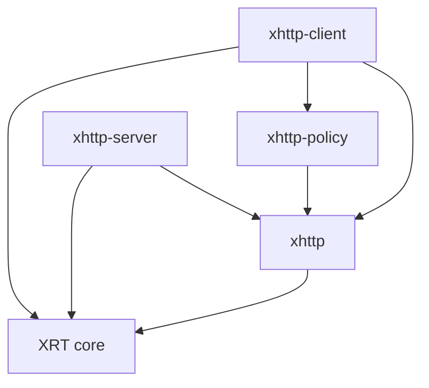

# HTTP 分层与迁移

| 层 | 负责 | 不持有 |
| --- | --- | --- |
| XRT core HTTP | HTTP/1 报文边界、基本头/正文线路编解码、限制与 TCP/TLS 接线 | 路由、策略、业务 Client/Server |
| xhttp | 字段解析/组装、完整消息对象、URL/表单/Multipart、Body/SSE codec、无 IO Exchange | 网络连接、监听器、CookieJar、缓存存储 |
| xhttp-client | 调用、拨号、取消、生命周期、可选连接池/TLS/Future；执行策略 | 服务器和路由 |
| xhttp-server | 监听和响应；可选路由/中间件/Mux/静态文件/SSE 服务 | 客户端和 CookieJar/缓存策略 |
| xhttp-policy | CookieJar、缓存状态、认证会话、重试/重定向决策 | 网络对象、计时器、Engine |

消息层处理现有 HTTP/1.1 能力，完整 Header 容器保留未知名称、重复值和顺序；正文的编码与流式生产不要求网络。高级名称的无 IO 对象继续留在这里，避免不必要的 API 改名与大规模重写。



跨库仅使用公开头与函数。`xrt/http_bridge.h` 是现有消息准备器/响应发送器需要的少量接线契约：不公开内部结构布局，不增加通用插件或回调注册框架。请求字段生产回调同步结束；WireBody/WireChunks 的引用与释放动作遵循原响应接纳时转移规则。读取 OriginalEncoding 等元数据的布局不会随客户端解压模块的有无而变化。

## 替换方式

| 原高层模块 | 现在的库/选择前缀 |
| --- | --- |
| http_client、stream、easy、Future、TLS/HTTPS、pool、cookies、cache、retry、redirect、SSE client | xhttp-client / XHTTP_CLIENT_MODULE_ |
| http_server、TLS/Future、raw/upgrade、route/router、middleware、mux、static/file、compress、SSE server | xhttp-server / XHTTP_SERVER_MODULE_ |
| cookie_jar、cache_policy/store/validate/range、Digest 计算/nonce/session/replay | xhttp-policy / XHTTP_POLICY_MODULE_ |
| Retry-After 解析/写出 | xhttp / XHTTP_MODULE_HTTP_RETRY |
| 默认重试集合/退避、构建重定向下一跳 | xhttp-policy / HTTP_RETRY_POLICY、HTTP_REDIRECT_POLICY |

每个库有独立 manifest、features、单头、归档和 DLL。Client 的 manifest 提供 policy 依赖可用性，但最小 http_client 闭包不会选择 CookieJar、缓存或自动重试。Server 不依赖 Client 或 policy。生产代码不包含别的产品的 src/internal。

先定义最外层选择并按 Client→Policy→xhttp→核心的顺序解析 features，再按核心→xhttp→Policy→Client 的顺序提供实现。Server 只需 Server→xhttp→核心的 features 与逆序实现。核心实现仅一份，多翻译单元通过普通外部符号链接。

网络生命周期、取消、错误传播、正文释放、关闭/Upgrade 的契约保留；同一配置应在全部翻译单元中一致。旧高层聚合宏需要迁移，C 函数和类型名称继续使用原名称。

## 验证入口

四套模块化测试、各叶子单头测试、最小裁剪测试和静态/动态消费者验证相互独立。`tools/test_http_layout.py` 防止基础库重新引入网络/策略状态或私有源码依赖。
纯协议基准在 xhttp，客户端 TCP 回环、服务器路由与策略退避各自在其所属产品。端到端 Client+Server 的旧回环基准保留为组合 profile：

```sh
python tools/measure_performance.py --manifest extlibs/xhttp-client/config/modules.json --config extlibs/xhttp-server/config/integration_profiles.json --smoke
```

## 本次改造验证

2026-10-12 在 Windows/x64、GCC 16.2.0、C11 下完成：

- 四库组合的 459 个模块化测试和 191 个单头测试全部通过；单头测试按真实模块选择，汇总节点不再注入全库功能。
- 各库最小裁剪、公共声明和完整 C 单头编译、公开接口多翻译单元链接通过。基础库与策略库的闭包不包含网络运行时，Client 和 Server 不互相引入源码。
- 最小 Client 与四库完整组合的独立静态归档、独立 DLL 和发布消费者通过；扩展归档没有重复定义核心符号，每个生产源文件只有一个所属库。
- 迁移后的完整示例编译、四库各自性能 smoke、Client+Server 组合回环 smoke、features/单头/API 文档同步和严格发布成熟度检查通过。
- Core 新增字段扫描入口的参数、边界、重叠与未对齐输出测试通过；原有 TLS、取消、内存失败、压缩、文件服务及 Upgrade 所有权测试保留并通过。

完整 xhttp 单头闭包的 O2 对象代码段从改造前的 2,050,568 字节降至 793,764 字节，减少约 61.3%。该数字包含所选核心闭包，不代表最终应用的可执行文件体积，也不代表将全部扩展一起链接时的总量下降。URL 最小闭包为 61,828 字节；三个新库的最小闭包分别为 Client 476,632、Server 405,620、Policy 41,256 字节。应用仍应选择实际需要的模块。

完整回归入口：

```sh
python tools/build.py --compiler gcc --arch x64 --manifest extlibs/xhttp-client/config/modules.json --manifest extlibs/xhttp-server/config/modules.json --suite xhttp_tests,xhttp_policy_tests,xhttp_client_tests,xhttp_server_tests --no-examples --jobs 1
python -m unittest tools.test_http_layout tools.test_http_linkage tools.test_package tools.test_api_docs tools.test_api_reference
```

本次本地执行覆盖 Windows 的 select/IOCP；Linux/io_uring 等其他平台使用已更新的 CI 配置继续验证。
