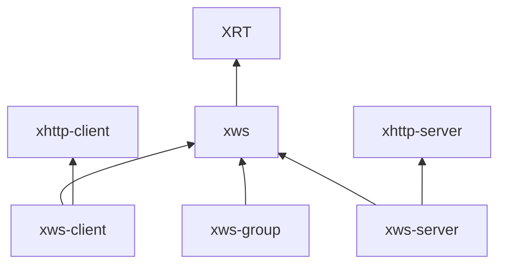

# WebSocket 扩展边界

四个扩展复用现有实现，不增加新的业务功能。

| 产品 | 职责 | 不承担的能力 |
| --- | --- | --- |
| XRT WebSocket core | 帧、掩码、消息协议、UTF-8、Close、握手原语、压缩原语及已有底层 Stream | 应用会话、路由和广播 |
| xws | 已建立 TCP/TLS 连接、消息收发、背压、Writer、引用、Future、关闭 | HTTP、拨号、监听、路由、连接集合 |
| xws-client | HTTP 客户端握手、响应验证、协商、接管连接 | 监听、服务端 Upgrade、路由和广播 |
| xws-server | HTTP 服务端 Upgrade、协商、连接交接；可选 Router 集成 | 客户端拨号和广播 |
| xws-group | 成员引用、快照、广播、逐连接结果与取消 | HTTP、鉴权、房间和业务消息 |



客户端和服务端成功后交付同一类 `xwsconn`。TLS、压缩、Future 与 Writer 是所属库的可选模块，不为每个变体新建产品。Router 只属于 xws-server 的可选模块。

## Upgrade 交接

1. HTTP 层拥有并驱动 Stream，解析和验证握手。
2. 握手成功后停止 HTTP 消费，向 xws 转移一个调用方拥有引用。
3. 未消费输入保留在 Stream 缓冲，xws 在下一次 Worker 循环解析，早到帧不会丢失。
4. 同步失败不转移输入传输；异步失败、取消与最终结果释放遵守原拥有引用契约。

不得同时启动两套读取驱动；同一个引用不得释放两次。握手、拒绝响应、早到帧、取消、内存失败、TLS、压缩和关闭测试都随实现迁移。

## Future 结果

旧 `xwsopenresult` 混合服务端连接和客户端 HTTP Response，导致两个产品共享条件结构。现在客户端返回 `xwsclientresult` / `xrtWsClientResult*`，服务端返回 `xwsserverresult` / `xrtWsServerResult*`。两者只管理自己交付的资源，不新增通用载荷或插件机制。

公开配置与握手快照保持固定布局；可选实现仍被功能宏裁剪。不透明连接布局由 xws 私有维护，其他产品通过公开接口访问，不导入其私有头。

## 构建

每个产品维护自己的清单、入口、单头、声明头、测试、示例和验证配置。xws 与 xws-group 不声明任何 HTTP 清单依赖。xws-server 清单包含 xws-client 供集成测试使用，生产模块闭包仍只包含服务端所需能力。

集成测试属于 xws-server，连接测试属于 xws，客户端独立测试属于 xws-client，成员与广播测试属于 xws-group。最终宿主只提供一份 XRT 与每个所选依赖实现。

## 改造验证（2026-10-12）

本地环境为 Windows x64、GCC 16.2、C11，编译启用 `-Wall -Wextra -Werror`。以下门禁均已通过：

- 四个 `*_tests` 套件：58 个不同的模块化测试、27 个不同的单头测试；覆盖 TCP/TLS、压缩、Writer、Ref/Copy/Take、Future、内存失败、Upgrade 早到数据、取消、关闭、路由及广播。
- 16 个原有示例编译并运行；连接巡检保留真实握手、发送、流控和关闭验证。
- Python 原始帧客户端到 XRT 服务端、XRT 客户端到 Python 服务端的双向互操作。
- Select 与 Windows IOCP 各 1000 轮重连。
- 四库分别编译并链接同一份 Core；静态库和独立 DLL 的四个消费者均能运行。DLL 只导出自己的 API，归档不嵌入 Core 或 HTTP 的实现。
- 七项产品边界与公共布局检查、四项单头边界检查、最小模块依赖裁剪检查；全部 API 文档与发布成熟度检查。
- 四个性能冒烟配置和九个体积配置；禁止的其他产品符号均为零。冒烟结果用于确认可运行，不用于宣称性能提升。

本地未执行 Linux、MSVC、TCC 门禁；对应产品已接入现有 CI。该记录只验证 WebSocket 改造，HTTP 源码与架构由另一个线程负责。

基础 xws 从原来的 15 个 C 实现文件收敛为 5 个；全部四库合计 16 个 C 实现文件，增加的一个来自客户端与服务端结果对象分别归属。TLS、压缩、Writer 和 Future 保留为可选模块，没有新增房间、鉴权、持久化、重连策略或插件框架。

复现完整回归可依次执行（例）：

```powershell
python tools/build.py --manifest extlibs/xws/config/modules.json --suite xws_tests --arch x64 --no-examples --jobs 1
python tools/build.py --manifest extlibs/xws-client/config/modules.json --suite xws_client_tests --arch x64 --no-examples --jobs 1
python tools/build.py --manifest extlibs/xws-server/config/modules.json --suite xws_server_tests --arch x64 --no-examples --jobs 1
python tools/build.py --manifest extlibs/xws-group/config/modules.json --suite xws_group_tests --arch x64 --no-examples --jobs 1
```

本次原始记录位于 `out/*-verified-final.log`、`out/*-examples-final.log`、`out/ws-interop-final.log`、`out/ws-stress-*-final.log`、`out/ws-package-*-separate.log`、`out/ws-layout-final.log`、`out/ws-single-boundaries-final.log`。这些是本地生成产物，不作为源码提交。
